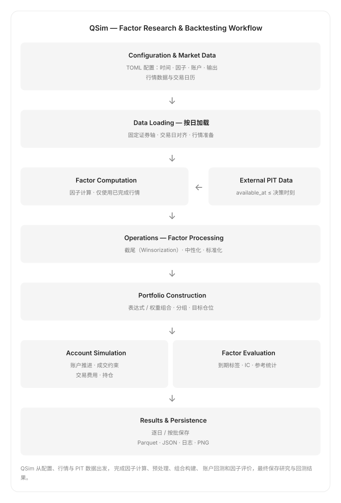
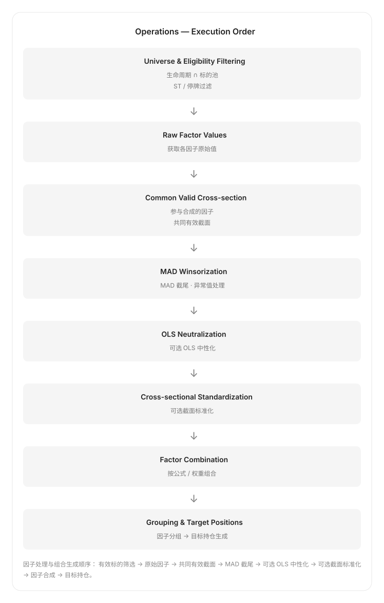
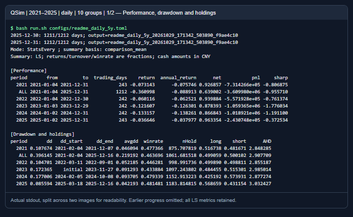
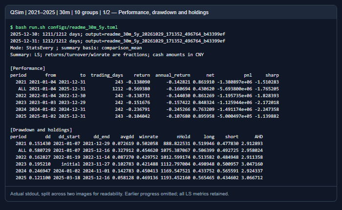
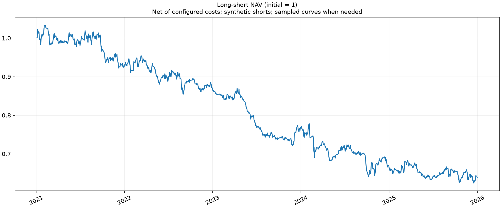
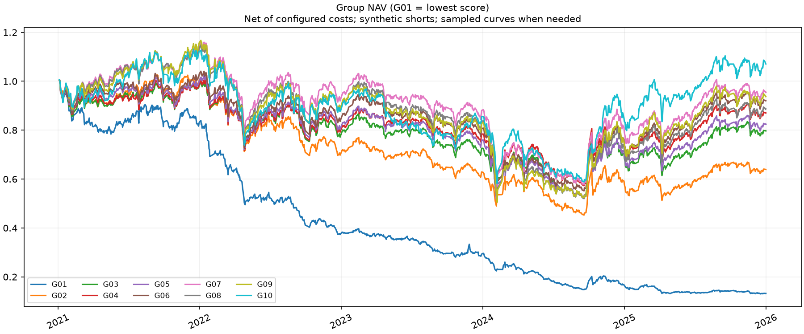
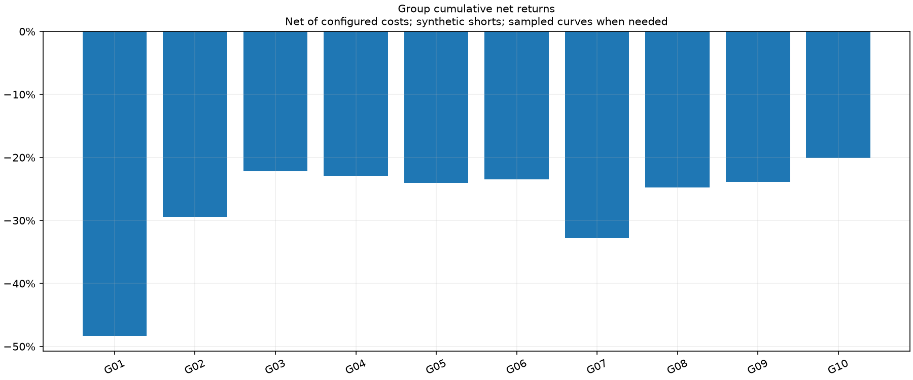
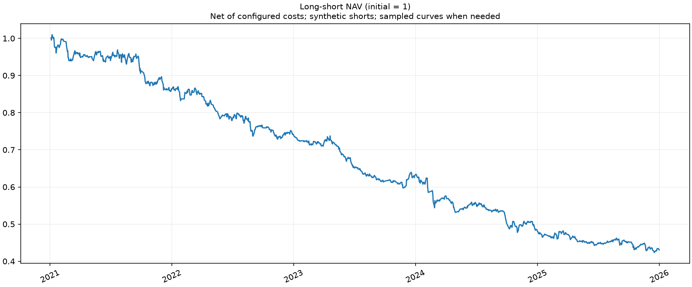
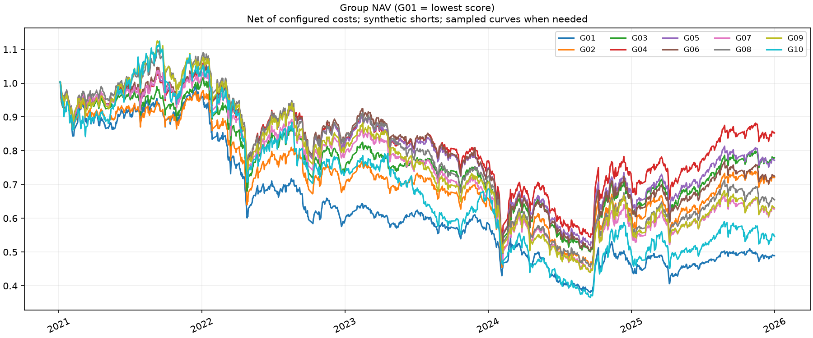
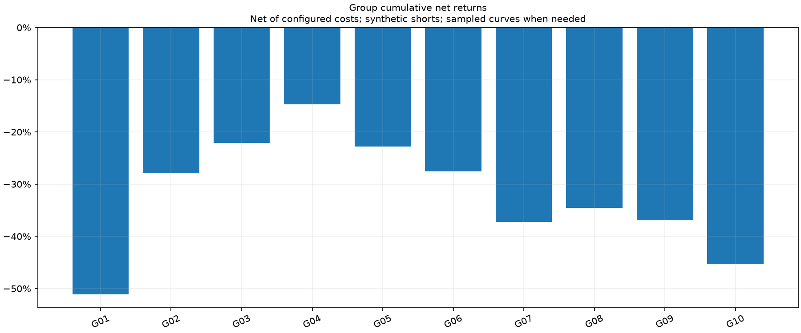

# QSim

QSim 是面向横截面 alpha 的回测基础设施。你提供行情、因子和运行配置，QSim 按信息可用时间计算信号，完成因子处理、分组、交易模拟和统计，将过程与结果保存为可追溯的文件。

- **输入**：NAS 上准备好的行情数据集，以及带可用时间的因子、标的池、ST 和中性化暴露表。
- **计算**：外部因子、内置价量因子或表达式；截面截尾、中性化、标准化与组合。
- **回测**：日频、1/5/30 分钟；固定时点独立账户或区间连续调仓。
- **验证**：IC、分组与多空表现，以及可选的未来数据、历史起点、checkpoint 一致性检查。
- **输出**：终端进度、日志、Parquet 明细、JSON 汇总和独立 PNG。

QSim 执行研究者给定的因子逻辑，不负责自动寻找因子或划分训练样本。回测与一致性检查通过，不代表因子有预测能力或策略可以盈利。



**阅读路线**：[安装与首次运行](#安装与首次运行) → [完整配置](#完整配置示例) → [因子与处理流程](#因子如何进入回测) → [选择回测模式](#选择回测模式) → [查看结果](#查看结果)。

详细说明：[运行指南](document/USAGE.md) · [配置字典](document/CONFIGURATION.md) · [输入数据规范](document/DATA.md) · [输出与排错](document/OUTPUTS.md) · [统计公式](STATS.md)。

## 安装与首次运行

### 1. 安装依赖

使用 **Linux、Python 3.11+**。共享缓存使用文件锁，资源监控读取 Linux 信息；其他操作系统尚未验证。依赖为 NumPy、pandas、PyArrow、Matplotlib、threadpoolctl，安装时自动解析，版本下限见 [pyproject.toml](pyproject.toml)。当前 CI 使用 Python 3.11。

本文默认已挂载共享 NAS，行情已准备好，不涉及数据下载。在你的项目目录克隆仓库并进入 QSim。缓存与结果使用独立存储目录，不混入源码：

```bash
git clone https://github.com/YSZN-Ainvest/Qsim.git
cd Qsim

# 与配置中的缓存／输出根目录保持一致；可以改为自己的 NAS 工作目录。
export QSIM_STORAGE_ROOT=/mnt/nas/qinml_cache/qsim
export TMPDIR="$QSIM_STORAGE_ROOT/tmp"
export XDG_CACHE_HOME="$QSIM_STORAGE_ROOT/cache"
export PIP_CACHE_DIR="$XDG_CACHE_HOME/pip"
export MPLCONFIGDIR="$XDG_CACHE_HOME/matplotlib"
export PYTHONPYCACHEPREFIX="$XDG_CACHE_HOME/pycache"
export QSIM_CACHE_ROOT="$XDG_CACHE_HOME/qsim"
export SQLITE_TMPDIR="$TMPDIR"
mkdir -p "$TMPDIR" "$PIP_CACHE_DIR" "$MPLCONFIGDIR" "$PYTHONPYCACHEPREFIX" "$QSIM_CACHE_ROOT"

export OMP_NUM_THREADS=1 OPENBLAS_NUM_THREADS=1 MKL_NUM_THREADS=1
export NUMEXPR_NUM_THREADS=1 ARROW_NUM_THREADS=1 ARROW_IO_THREADS=1

python3.11 -m venv .venv
source .venv/bin/activate
python -m pip install -e .
```

已有 Python 环境时，激活它后执行最后一行即可。`python -m qsim` 与安装后的 `qsim` 命令等价。也可使用 [run.sh](run.sh) 自动设置 NAS 缓存与线程变量；通过 `QSIM_PYTHON` 指定解释器，避免选到其他环境：

```bash
QSIM_PYTHON="$PWD/.venv/bin/python" bash run.sh configs/tutorial.toml
```

### 2. 使用现有 NAS 数据运行

先跑 [tutorial.toml](configs/tutorial.toml)：短日期范围、全A池、10分组，开启日志、因子值、持仓和图表输出，用于检查配置和dump。下文正式结果展示使用另外两份五年配置，避免用短样本曲线解释分层表现。

```bash
# 检查配置，并打印合并默认值后的最终配置；此步不读取行情。
python -m qsim --config configs/tutorial.toml --validate

# 使用真正的数据加载器和回测入口运行，并保存结果。
python -m qsim --config configs/tutorial.toml
```

示例显式设为 `st_unknown="allow"`：ST 状态未知时允许通过，并写入审计，不代表已经完成历史 ST 过滤。正式任务应根据自己的输入覆盖选择 `error` 或 `exclude`。

### 3. 改成自己的回测任务

复制 [完整配置模板](configs/tutorial.toml)，按以下顺序修改：

1. 保留或修改共享 NAS 的 `data.root`、`data.raw_root`。前者是 QSim 行情数据集，后者是原始日线；两者格式不同，见[目录与字段](document/DATA.md#行情目录与字段)。
2. 配置 `data.cache_directory`、`output.directory` 和可选的 `livetest.report_directory`。路径不会展开 `$变量` 或 `~`；建议写绝对路径。
3. 指定起止日期、采样频率、回测模式和标的池。预热数据必须位于起点之前。
4. 为每个 alpha 配置来源、数值列或计算逻辑，选择 operations 和合成方式。
5. 先 `--validate`，再用小标的池、短区间运行，检查信号覆盖、日志、输出和可选 livetest，最后扩大规模。

已有 NAS 行情可以直接复用，新增外部因子只需按 [PIT 表规范](document/DATA.md#外部-pit-表)准备列和可用时间。研究任务不要修改共享行情源文件。

## 完整配置示例

TOML 是可读的配置文本：`[section]` 表示配置段，`key = value` 表示参数。下面就是可直接运行的 **tutorial.toml 全文**，没有省略配置块。日期、证券、资金和处理参数是示例选择，可以按任务修改。

| 配置段 | 先决定什么 | 详细说明 |
|---|---|---|
| `data` | 行情、日历、预热和共享缓存 | [数据参数](document/CONFIGURATION.md#data) |
| `backtest`、`stats` | 时间、采样、账户模式、执行窗口和标签期限 | [回测参数](document/CONFIGURATION.md#backtest) |
| `universe` | 静态证券列表或历史时点标的池 | [标的池](document/CONFIGURATION.md#universe) |
| `alphas`、`combine` | 每个因子的定义与组合公式 | [因子参数](document/CONFIGURATION.md#alphasname-与-combine) |
| `operations` | ST、截尾、中性化和标准化 | [处理参数](document/CONFIGURATION.md#operations) |
| `execution` | 成交限制与费用 | [执行参数](document/CONFIGURATION.md#execution) |
| `compute` | 因子线程池、回测进程池和内存预算 | [计算参数](document/CONFIGURATION.md#compute) |
| `output`、`livetest` | 保存内容与可选一致性检查 | [输出参数](document/CONFIGURATION.md#output) |

```toml
# Complete walkthrough using the shared NAS market data.
# Paths are literal: QSim does not expand shell variables inside TOML.
[data]
root = "/mnt/nas/qinml_cache/backtesting/20260930"
raw_root = "/mnt/nas/data/whole_history"
warmup_days = 30
cache_directory = "/mnt/nas/qinml_cache/qsim/cache"
batch_rows = 4096
shared_cache = true
pit_columns = {}

[backtest]
start = "2024-01-02"
end = "2024-01-19"
frequency = "0800"
mode = "StatsEvery"
holding_period = 1
forecast_period = 5
groups = 10
capital = 1000000.0

[stats]
nIntvDelay = 1
idelayEach = 0
ileadEach = 5
isTradeT1 = true
nbar = 1
priceMode = "vwap"
cleareod = false
signal_times = []

[universe]
kind = "all_a"
symbols = []
path = ""

[alphas.momentum]
kind = "momentum"
lookback = 20
weight = 1.0

[alphas.reversal]
kind = "reversal"
lookback = 5
weight = 1.0

[combine]
expression = "0.5*(<momentum> + <reversal>)"
stage = "processed"

[operations]
exclude_st = true
st_unknown = "allow"
st_path = ""
winsor_mad = 5.0
standardize = true
exposures_path = ""
neutralize_styles = []
neutralize_industries = []
min_cross_section = 20

[execution]
fee_bps = 5.0
sell_tax_bps = 0.0
slippage_bps = 0.0
borrow_bps_annual = 0.0
participation = 0.01
limit_filter = true
suspension_filter = true
reject_bad_vwap = true
short_mode = "synthetic"
enforce_t1 = true

[compute]
pools = 1
batch_pools = 1
memory_per_job_mb = 512

[output]
dump = true
directory = "/mnt/nas/qinml_cache/qsim/result"
name = "tutorial"
plots = true
positions = true
factors = true
stream = true
materialize = false
csv = true
plot_points = 2000
factor_batch_rows = 65536

[livetest]
times = []
starts = []
warmup_days = 30
samples = 3
seed = 17
atol = 1e-10
rtol = 1e-8
max_samples = 5
max_records = 1000000
worker_timeout = 300
report_directory = "/mnt/nas/qinml_cache/qsim/result/livetest"
```

所有公共参数的类型、默认值、作用和模式限制见[完整配置字典](document/CONFIGURATION.md)。上面的数值是教程选择，不等同于所有默认值。`[livetest]` 只配置检查行为；没有 `--livetest` 就不会执行检查。

## 因子如何进入回测

### 外部因子、内置因子与表达式

外部表使用 CSV 或 Parquet；同一张宽表可以装很多因子列。每行代表**某个标的在某个信息可用时点的一次更新**：

| order_book_id | available_at | quality | value |
|---|---|---:|---:|
| 000001.XSHE | 2024-01-16 07:30:00+08:00 | 0.32 | -0.15 |
| 000002.XSHE | 2024-01-16 07:30:00+08:00 | -0.08 | 0.41 |

上表仅说明字段。`order_book_id` 必须与行情证券轴一致；真实数据保留交易所后缀。`available_at` 是信息能被策略知道的时间，不是报告期或收益归属日期。07:30 发布的数据可用于 08:00 信号，08:01 才发布的数据不能用于 08:00。

每个 `[alphas.NAME]` 是独立配置：`kind="table"` 指明表因子，`path` 是来源，`column` 是数值列。相同路径的多个因子共用读取状态，不为每列复制整张表。

也可以使用内置 `momentum`、`reversal`、`volatility`，设置 `lookback`；单位是已完成的采样 bar。派生因子使用 `kind="expression"`。各类型的完整配置和计算定义见[因子参数](document/CONFIGURATION.md#alphasname-与-combine)。

组合支持这样的公式：

```toml
[combine]
expression = "0.25*(<alpha1> + <alpha2> + <alpha3> + <alpha4>)"
stage = "processed"
```

四个名字需分别有 alpha 配置。公式支持有限算术与截面函数，不执行任意 Python；滚动指标通过因子配置表达。未写公式时，按各因子的 `weight` 加总，权重不会自动归一化。

### Operations 的执行顺序



默认先各自处理，再组合。截尾限制极端值；中性化去除配置的风格和行业线性暴露；标准化让不同尺度的因子可以组合。中性化需要对应历史时点的暴露表，不能用今天的行业回填历史。

参与合成的任何分量缺失，该股票就不进入本次共同有效截面；不会临时对剩余因子重新分配权重。`min_cross_section` 控制最少有效证券数。全截面无可分组信号时如何处理既有账户，见[逐时点流程](document/USAGE.md#一个决策时点发生什么)。

因子、标的池、ST 和暴露的字段、缺失值与更新规则分别见[外部表接口](document/DATA.md#外部-pit-表)。

## 选择回测模式

采样频率决定“什么时候产生信号”，回测模式决定“这些信号如何作用于账户”。同样一天 8 根 bar，Every 与 Interval 的账户含义不同。

| 比较项 | StatsEvery | StatsInterval |
|---|---|---|
| 账户组织 | 每个可执行的采样时点各自维护一套策略账户 | 每个组合维护一套沿时间连续更新的账户 |
| 信号作用 | 更新该日内时点对应的账户，不改其他时点账户 | 更新同一账户，承接上一区间的现金和持仓 |
| 默认调仓节奏 | 每个账户每天在自己的固定时点调仓一次 | 依 nbar 对日内采样 bar 分段，逐段调仓 |
| 主要窗口参数 | nIntvDelay、signal_times | nbar、priceMode、signal_times |
| 主结果 | 各时点账户的等初始资金比较均值 | 该连续账户的实际日曲线 |
| 适合回答 | 同一因子在不同日内时点执行，各自表现怎样？ | 同一策略持续接收日内信号并交易，结果怎样？ |

### StatsEvery：由 bar 网格决定独立时点账户

Every 不限于手选两个时点。默认 `signal_times=[]`、`nIntvDelay=1` 时，每个 bar 起点都产生一个信号，并对应一套独立策略：

| frequency | 每日采样 bar | 独立时点策略数 |
|---|---:|---:|
| `0800` | 1 | 1 |
| `0930-1500-30` | 8 | 8 |
| `0930-1500-5` | 48 | 48 |
| `0930-1500-1` | 240 | 240 |

表中是完整交易日、全部时点、默认执行延迟的情况。缩短窗口、筛选 signal_times 或加长延迟，都会改变实际可执行时点数；例如 `0930-1450-5` 有 46 根 bar。

以全日 30 分钟、一天 8 根 bar 为例，8 个决策时点是 **09:30、10:00、10:30、11:00、13:00、13:30、14:00、14:30**。09:30 账户今天用09:30信号调仓，持有至下一交易日自己的调仓时点；10:00账户独立做同样的事。日内后续信号不会改写前一时点账户。

```text
时点账户       第一天                     第二天
09:30         09:30信号 → 调仓 ──持有──→ 09:30信号 → 调仓
10:00         10:00信号 → 调仓 ──持有──→ 10:00信号 → 调仓
  …             其他时点各自独立            各自续接持仓
14:30         14:30信号 → 调仓 ──持有──→ 14:30信号 → 调仓
```

每套时点策略内部都有分组和多空比较账簿。10分组对应 G01–G10；每组各有配置的初始资金，LS 的多头、空头两侧各分配一半资金，不能把这些比较账簿的收益直接加成一个账户收益。

成交也不发生在“已经知道整根bar价格之后再回头下单”：09:30先计算信号，默认使用 `(09:30,10:00]` 的VWAP模拟成交；`nIntvDelay=2`则用下一根窗口。延迟按网格跨午休，但不跨交易日，越过当天终点的信号跳过。日频08:00只有一套策略，使用当天全天VWAP作为执行窗口。

**主结果怎么汇总？** `slot_daily/slot_summary` 保留8套账户各自结果；主 `daily/summary` 对同一组合的8套等初始资金账户取比较均值。PnL金额、净资产先取均值，日收益由这条汇总曲线计算，Sharpe和回撤也在汇总曲线上计算，不能把8个Sharpe简单平均。例如两套各100万的账户分别赚1万、亏0.4万，主结果是平均PnL 0.3万、收益0.3%。

### StatsInterval：同一账户逐区间承接状态

Interval 不为每个日内时点新建策略账户。同一分组或LS账户的现金、持仓、费用一直沿时间推进，下一段信号会在已有持仓基础上调整。

全日30分钟网格下，`nbar=1` 表示8段、最多8次目标更新；`nbar=2` 把每两根bar组成一段，形成4段，使用每段起点的因子。默认完整网格的首段为 `(09:30,10:30]`，下一段为 `(10:30,11:30]`，午休后继续，区间不跨交易日。

```text
同一账户：09:30信号 → 第一段执行 → 10:30信号 → 第二段执行 → …
                      现金、持仓、成本连续传递
```

- `priceMode=vwap`：将段内成交额、成交量分别求和后相除；不是各bar的VWAP简单平均。`open`用段首开盘价，`close`用段尾收盘价。
- `signal_times=[]`使用全部采样bar；若筛选为稀疏时点，nbar对选中bar列表分段，未选中bar不计入执行窗口。
- 尾部不足nbar时截断。参考 `stats_*` 收益仍按配置nbar归一化，实际账户PnL不除以nbar。
- `cleareod=true`只重置参考统计中的lastAlpha，不代表日终平仓；实际T+1由 `execution.enforce_t1`控制。

两种模式均按配置费用和成交约束推进账户，目标权重不保证全部成交。`stats.isTradeT1`仅影响Every参考换手的均值／求和，不是实际T+1开关。完整参数见[运行指南](document/USAGE.md#选择采样与账户模式)，公式见[统计口径](STATS.md)。`Cohort`保留为按批次持有的兼容模式，新任务优先按以上调仓含义选择Every或Interval。

## 按需要运行

在已激活环境、设置好存储与线程变量的项目目录执行：

| 情况 | 命令 |
|---|---|
| 检查配置，不读行情 | `python -m qsim --config configs/tutorial.toml --validate` |
| 普通回测 | `python -m qsim --config configs/tutorial.toml` |
| 同一配置内并行计算因子 | `python -m qsim --config configs/tutorial.toml --factor-pools 2` |
| 多个配置独立回测 | `python -m qsim --config configs/local_a.toml configs/local_b.toml --pools 2` |
| 只做 alpha 一致性检查 | `python -m qsim --config configs/tutorial.toml --livetest all` |
| 小规模调试，不保存回测输出 | `python -m qsim --config configs/tutorial.toml --no-dump` |

多配置前先准备各自的 TOML；`--pools` 是配置任务进程数，`--factor-pools` 是每个任务的因子线程数。实际数量会按资源预算降低，不是设置多少就一定启动多少。账户时间轴和 StatsEvery 时点账户不并行调度。

同一时点的股票用 NumPy 数组向量化计算；因子按依赖层计算并复用相同基础结果；进程通过版本化缓存共享源数据。事件、持仓和因子值按日或批写出，只保留当前状态、滚动窗口和待到期标签。详见[计算与内存](document/USAGE.md#计算与内存)；读取／对齐、批量统计和落盘优化的同配置对照见[性能验证](document/PERFORMANCE_RESULTS.md)。

### 数值精度

**当前生产计算链路使用 float64（64位双精度），没有float32计算模式或自动降精度开关。** 行情截面在进入计算数组时转换为float64；外部因子数值、operations、表达式、目标权重、现金／持仓／净资产与统计累计沿用双精度。账户数值和因子值写入Parquet时为double；证券标识、日期、布尔状态和计数保留各自适用类型。

float64约有15–16位十进制有效数字，不是固定保留15位小数。终端的显示位数不改变底层精度，CSV／JSON是文本格式，没有float32／float64列类型；程序读取仍应使用双精度。如果源因子先按float32存储并发生舍入，后续转成float64不能恢复丢失的信息。双精度减少数值误差，但正确性仍需靠PIT检查、账户对账和统计验证。

`--no-dump` 走内存路径，不适合长任务，且不保存运行日志；输入缓存仍可能创建。生产运行保留 `dump=true, stream=true, materialize=false`。大任务先测小样本，检查可用内存、CPU 与 cgroup 配额，显式限制并发，并用调度器或 cgroup 设置硬限制。

## 查看结果

运行中终端逐日打印进度，结束后显示多空组合的年度与全期完整统计，以及实际输出路径。终端按四块排版，所有已有LS汇总指标都会显示：

| 分块 | 指标 |
|---|---|
| 收益 Performance | 起止日期、交易日数、return、annual_return、net、pnl、sharp |
| 回撤与持仓 Drawdown and holdings | dd、**dd_start、dd_end、winrate**、avgdd、nHold、long、short、AHD |
| 交易与成本 Trading and costs | tvr、net_tvr、bp_mrgn、holdret、traderet、tradecost、tradecost_cash |
| 因子评价 Factor diagnostics | IC、ICIR、rank_IC、rank_ICIR、auto_corr、Tstat、TC、ic_observations |

收益率、换手和胜率以小数显示，0.5表示50%；PnL和成本金额以元显示。`dd_start/dd_end`是最大回撤对应的峰值／谷值日期，`winrate`是日净收益大于0的天数占比，包含未交易日。详细过程及时写入文本和JSONL日志；图表在汇总完成后生成，不弹出窗口，也没有dashboard。

### 五年、10分组的实际示例

两份示例都使用 **2021-01-01 至 2025-12-31、历史全A池、10组**，保持相同费用与交易约束。不是筛选收益更好的片段，也不拿不同调仓频率的表现直接判定哪种策略更优。

| 设置 | 日频 | 30分钟 |
|---|---|---|
| 配置 | [readme_daily_5y.toml](configs/readme_daily_5y.toml) | [readme_30m_5y.toml](configs/readme_30m_5y.toml) |
| 频率／模式 | 0800 / StatsEvery | 0930-1500-30 / StatsEvery |
| 每日bar／时点策略数 | 1 / 1 | 8 / 8 |
| 分组 | G01–G10 | G01–G10 |
| 因子窗口 | 20日动量、5日反转 | 160根动量、40根反转（完整8bar网格下约20／5交易日） |
| IC期限 | 5根日bar | 40根30分钟bar |
| 导出 | 流式账户明细、统计与图表；关闭大规模因子／每日持仓dump | 同左 |

```bash
# 长任务：先测短区间、确认资源和输出量，再执行完整五年配置。
python -m qsim --config configs/readme_daily_5y.toml
python -m qsim --config configs/readme_30m_5y.toml
```

**分层回测怎样分组？** 每个信号截面将有效股票按因子分数从低到高排序，分成尽量等数量的10组，每组内目标等权；不能分组的无效股票排除。G01最低、G10最高；分数相同时使用稳定证券顺序。各组独立运行并扣除交易费用，LS做多G10、做空G01，两侧各占一半资金。5组也支持，配置 `groups=5` 即可。

分组曲线和柱状图用于观察分层差异与单调性，不要求结果一定单调。组间持仓可能因容量、停牌、T+1等约束偏离当期目标；组别净值不是无成本的前瞻收益均值。示例仍显式允许未知ST，并使用合成空头。

**日频：年度／全期收益、回撤日期与胜率**



**30分钟：8时点比较组合的年度／全期摘要**



截图来自各自完整运行的stdout排版，数值未改；为便于阅读分为上下两张，上图展示收益与回撤，成本及全部因子指标的下半张见[五年完整结果](document/FIVE_YEAR_EXAMPLES.md)。原始日志保留全部逐日进度。字段解释和读取代码见[输出说明](document/OUTPUTS.md)。

每次回测创建一个独立运行目录。下面展示结构；`part-*.parquet` 是数据文件，带 `.parquet` 后缀的上级目录是整个数据集：

```text
<output.directory>/<name>_<timestamp>_<run_id>/
├── config.json / audit.json / manifest.json
├── summary.json / summary.csv / summary.parquet/
├── daily.parquet/           # 账户日净值、PnL、换手
│   ├── part-00000000.parquet
│   └── part-00000001.parquet
├── events.parquet/          # 账户事件与损益归因
├── diagnostics.parquet/     # IC、覆盖、标签状态
├── factors.parquet/         # 可选：原值、处理后值、组合值
├── positions.parquet/       # 可选：每日持仓
├── final_positions.parquet/ # 期末持仓
├── slot_daily.parquet/ / slot_summary.parquet/
├── stats_*.parquet/         # 按模式输出的目标 alpha 参考统计
├── benchmark_daily.parquet/
├── run.log / run.jsonl
├── long_short_nav.png / long_short_pnl.png
├── group_nav.png / group_returns.png / group_excess_returns.png
├── ic.png / turnover.png
└── COMPLETE                # 失败时为 INCOMPLETE，并附 failure.json
```

`daily/summary/events` 是受交易约束、扣除配置费用后的账户结果；`stats_*` 是目标 alpha 的参考统计。两者不能混为同一条净值。输出名称、字段、数值单位、读取方式、失败排查见[输出说明](document/OUTPUTS.md)。

以下图片分别由两份五年NAS数据回测直接生成。曲线保留整个区间，没有裁掉亏损年份，也没有将因子方向事后翻转。

### 日频：五年分层表现







### 30分钟：五年分层表现







完整图集及年度统计：[金额PnL、分组超额、IC、换手与验证记录](document/FIVE_YEAR_EXAMPLES.md)。

多空图观察净值和回撤；分组图观察不同分数组的表现；分组柱状图检查收益排序是否稳定，而不是要求每次都单调。超额图使用相同有效股票池、费用和执行约束下的等权基准，定义为“组净值 / 基准净值 − 1”。IC 和换手需要结合覆盖率、交易成本一起看。

因子导出为长表，键是 `(timestamp, instrument, alpha_name, stage)`，数值列是 `value`；`stage` 分别为 `raw`、`processed`、`combined`。`output.factors=true` 才保存。普通回测的完整因子导出与 livetest 的组合分数比较是不同用途。

## Livetest：alpha 计算一致性检查

livetest用于验证计算逻辑和状态恢复，不看收益是否赚钱，也不要求不同日期的因子值相等。它始终比较**同一决策时间、同一标的、同一组合alpha**在不同运行方式下的值。

| 检查 | 要回答的问题 | 怎么比较 | 主要能发现什么 |
|---|---|---|---|
| **f — Future test** | 今天的alpha是否读到了未来输入？ | 基准完整运行，与从输入层截断／扰动目标时点之后数据的独立运行，比较截至目标时点的输出 | 未来价格、过早使用尚未发布的表值等输入依赖 |
| **p — Past test** | 预热足够以后，改变启动日期是否影响共同区间的alpha？ | 选择多个交易日起点，各自重新初始化并取得声明的预热，只比较都完成预热后的共同区间 | 初始化、历史长度和启动日期依赖；预热不足会报数据不足 |
| **c — Checkpoint test** | 保存状态后重启，能否接上原来的计算？ | 连续运行作为基准；多个检查点保存alpha状态，在新进程恢复，对比恢复后的全部共同输出 | 漏存滚动窗口、递归量、随机状态或数据游标，重复／漏处理事件 |

```bash
python -m qsim --config configs/tutorial.toml --livetest f
python -m qsim --config configs/tutorial.toml --livetest p
python -m qsim --config configs/tutorial.toml --livetest c
python -m qsim --config configs/tutorial.toml --livetest f,p
python -m qsim --config configs/tutorial.toml --livetest all
```

不传 `--livetest` 就是普通回测；传入后只执行检查，不同时跑资金账户回测。可以配置检查时点、预热长度、随机种子、atol/rtol和报告路径；未指定时点时确定性选取多个时点并写入JSON报告。

检查会核对键集合、缺失和重复记录。浮点容差为 `abs(test-reference) <= atol + rtol*abs(reference)`；双方NaN不算有效证据，全部无效、数据不足或不支持都不能当作通过。显式请求的检查只有全部 `PASS` 才返回0，其他状态返回非零并保留报告。长区间／全市场检查有独立记录数限制，先选有充分预热的代表性短区间，不直接把多年回测当作无界livetest。

c检查的是alpha状态，**不是完整账户断点续跑**；f也不能认证上游行情加工或训练过程没有泄漏。详细参数、报告与覆盖范围见 [livetest](document/LIVETEST.md)。

## 当前边界

当前成交模型是 bar 级模拟：支持停牌、涨跌停、T+1、费用和成交量约束；空头为合成研究仓位，未模拟券源、整手和排队。使用复权分数单位，结束时不强制平仓。外部因子缺更会沿用最新值，尚无自动过期策略。

QSim 不强制划分 IS/OS。数据质量、真实发布时间、历史池和行业暴露由输入方保证；行情预处理和模型训练的未来泄漏不能仅靠回测内检查排除。

## 后续计划

下一阶段与 QD 协调以下数据工作。这里区分“接口已有”与“数据已具备可用于研究的覆盖”，不把接口存在当作数据验证完成。

| 计划 | 当前能力与缺口 | 下一步 |
|---|---|---|
| 历史 ST、停牌状态 | 停牌过滤与 ST 策略已有；历史 ST 尚未完整接入，状态覆盖和真实可用时间仍需核验 | 补齐历史状态与变更时间，验证缺失、停复牌边界及 PIT |
| 中性化风格暴露 | 行业／连续风格中性化接口已有，尚未配置经过完整时点验证的行业、市值等输入 | 与 QD 确定分类与风格定义，核对 NAS 现有数据，接入历史暴露 |
| 中证 500／1000 标的池 | 历史 table 池接口已有，指数历史成分尚未接入 | 接入历史成分变更与生效时间，不用当前成分倒推历史 |
| 官方复权／公司行动 | 已有基于历史昨收推算的复权数据，尚缺官方数据交叉核验 | 对接供应商复权／公司行动，验证分红、拆并股等边界 |
| 数据自动更新 | 当前预处理行情缓存截至 **2026-09-30**，没有完整自动日更流水线 | 建立增量更新、完整性检查、版本记录和失败告警 |

这些是数据完善计划，不表示已有回测和过滤功能不可用；扩展正式研究范围前，应先确认所需输入的历史覆盖。

---

[开发说明](CONTRIBUTING.md) · [版本记录](CHANGELOG.md) · [开发交接](document/QSIM_DEVELOPMENT.md)
