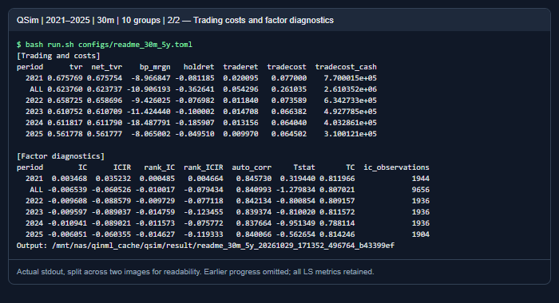
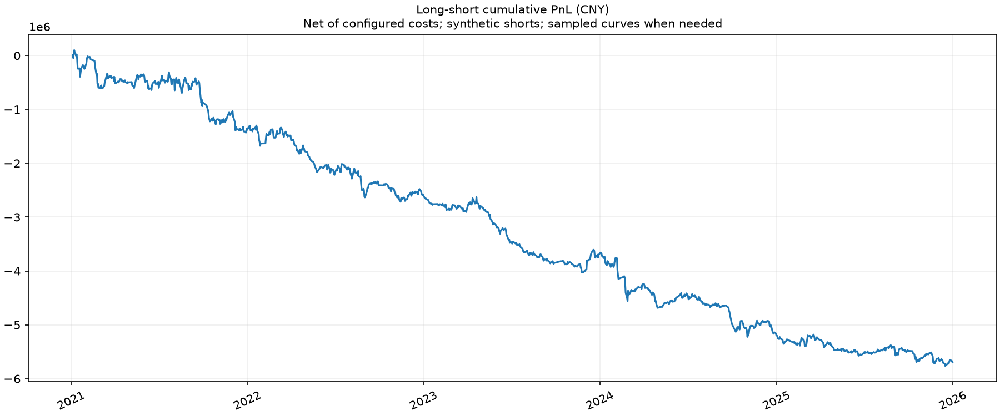
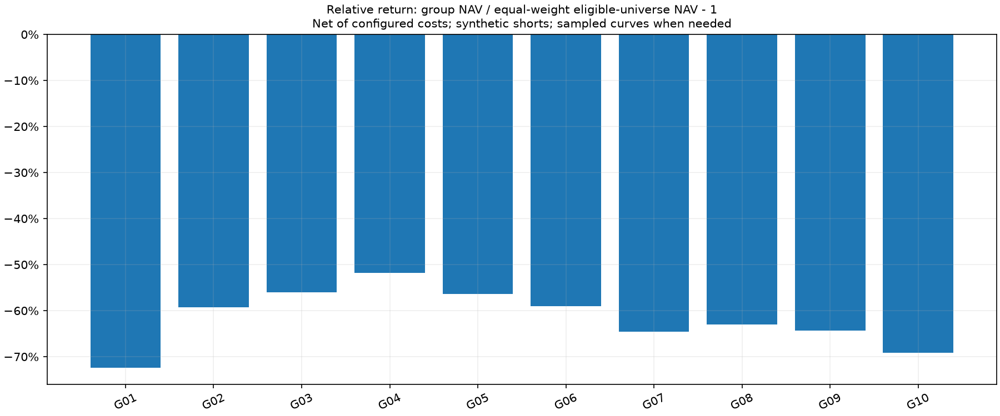
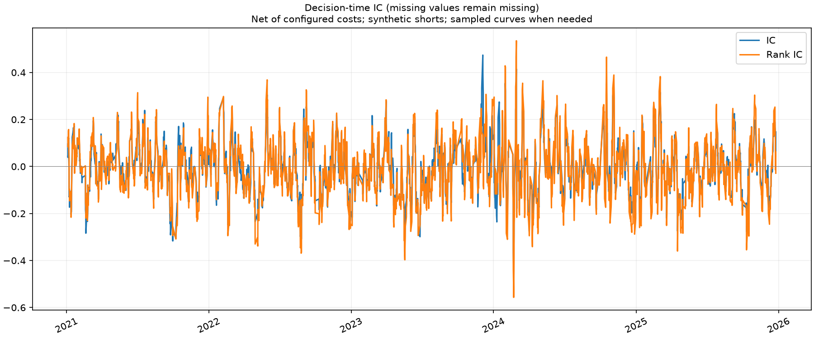
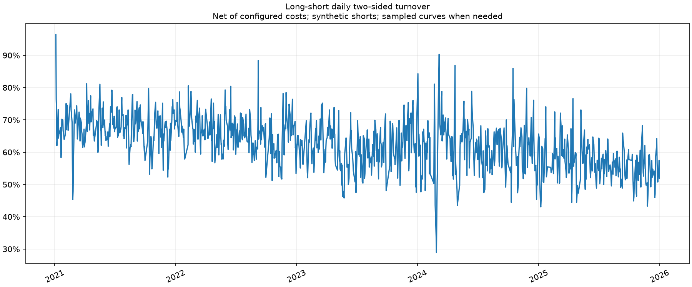

# 五年日频与30分钟分层回测

[返回 README](../README.md) · [输出字段](OUTPUTS.md) · [统计口径](../STATS.md)

这里记录可复现的长区间示例，展示输出与分层分析的读法。区间和参数在运行前确定，没有按收益选择股票、时段、因子符号或最优参数。结果不是因子推荐，也不将不同交易频率的收益直接当作优劣结论。

## 配置与样本

| 项目 | 日频 | 30分钟 |
|---|---|---|
| 完整配置 | [readme_daily_5y.toml](../configs/readme_daily_5y.toml) | [readme_30m_5y.toml](../configs/readme_30m_5y.toml) |
| 请求区间 | 2021-01-01—2025-12-31 | 同左 |
| 股票池 | 按每日历史生命周期变化的全A池 | 同左 |
| 分层 | 10组，G01最低、G10最高；组内目标等权 | 同左 |
| 模式 | StatsEvery，一个日频时点 | StatsEvery，8个日内时点独立策略 |
| 采样 | 0800 | 0930-1500-30，跳过午休 |
| 因子 | 20根动量与5根反转，分别处理后等权合成 | 160根动量与40根反转，分别处理后等权合成 |
| 标签跨度 | 5根日bar | 40根30分钟bar |
| 预热 | 起点前30个交易日 | 同左 |
| 初始资金 | 各分组1000万元，LS多／空各500万元 | 每个时点按相同配置独立初始化 |
| 成交与费用 | VWAP、单次成交5bps、容量1%、实际T+1 | 同左 |
| 缺失与限制 | 未知ST显式allow；合成空头；价格／状态约束按配置处理 | 同左 |
| 输出 | 流式Parquet、JSON、日志、独立PNG；因子与每日持仓大dump关闭 | 同左 |

同一完整交易日有8根30分钟bar，因此分钟因子窗口与标签跨度换算成约20／5个交易日，但信号、成交窗口和持仓路径仍不等同于日频策略。分钟主结果是8套时点策略的等初始资金比较均值，不是同一账户日内调仓8次。

## 运行方式

先按README设置环境、NAS目录与底层库线程，确认配额和资源；第一次可复制配置、把end缩短为若干交易日试跑，再执行五年：

```bash
python -m qsim --config configs/readme_daily_5y.toml --validate
python -m qsim --config configs/readme_30m_5y.toml --validate
python -m qsim --config configs/readme_daily_5y.toml
python -m qsim --config configs/readme_30m_5y.toml
```

五年配置不建议直接用于全量livetest。先选择覆盖代表性日历边界、有完整预热的短区间，避免超过重放记录数预算。不要为了让livetest通过而放宽容差。

## 实际结果

实际交易区间为2021-01-04至2025-12-31，共1,212个交易日；固定证券轴5,939个标识，每天实际可用池随上市／退市和信号有效性变化。两份运行最少有效信号数均为4,073。

两份运行均正常结束并有COMPLETE。以下是**LS账户实际净收益**，已经计入配置成本；结果为亏损，保留原值，不将它解释为因子能力证明。

| 示例 | 全期收益 | 最大回撤 | 回撤起点 | 回撤终点 | 日胜率 | 平均日双边换手 | IC |
|---|---:|---:|---|---|---:|---:|---:|
| 日频 | -36.10% | 39.61% | 2021-02-04 | 2025-12-16 | 46.37% | 63.86% | -0.003242 |
| 30分钟8时点均值 | -56.94% | 58.07% | 2021-01-07 | 2025-12-16 | 45.46% | 62.38% | -0.006539 |

### 日频年度

| 年度 | 净收益 | 最大回撤 | 日胜率 | IC | Rank IC |
|---|---:|---:|---:|---:|---:|
| 2021 | -7.31% | 10.77% | 47.74% | 0.007202 | 0.002355 |
| 2022 | -6.01% | 10.47% | 44.63% | -0.009205 | -0.011884 |
| 2023 | -12.16% | 17.24% | 43.39% | -0.005653 | -0.010844 |
| 2024 | -13.32% | 17.70% | 47.93% | -0.005313 | -0.008220 |
| 2025 | -3.66% | 8.56% | 48.15% | -0.003284 | -0.013682 |
| ALL | -36.10% | 39.61% | 46.37% | -0.003242 | -0.008429 |

### 30分钟年度

| 年度 | 净收益 | 最大回撤 | 日胜率 | IC | Rank IC |
|---|---:|---:|---:|---:|---:|
| 2021 | -13.81% | 15.14% | 50.21% | 0.003468 | 0.000485 |
| 2022 | -13.87% | 16.28% | 42.98% | -0.009608 | -0.009729 |
| 2023 | -15.17% | 19.52% | 42.15% | -0.009597 | -0.014759 |
| 2024 | -23.68% | 24.69% | 45.04% | -0.010941 | -0.011573 |
| 2025 | -10.40% | 12.11% | 46.91% | -0.006051 | -0.014627 |
| ALL | -56.94% | 58.07% | 45.46% | -0.006539 | -0.010017 |

### 核验与资源

对两份运行分别独立复算78条组合／年度／全期汇总的收益、净值、PnL、回撤及峰谷日期、胜率、换手和费用；并从slot_daily重建主账户均值。两份均通过，不只检查最后一天。账户数值的Parquet schema为double。此核验覆盖账户统计一致性，不替代源数据真实性或逐笔成交可行性认证。

| 项目 | 日频 | 30分钟 |
|---|---:|---:|
| 有效到期标签记录 | 1,207 | 9,656 |
| 终点右删失标签 | 5 | 40 |
| 最大逐事件损益对账误差（元） | 5.42e-09 | 6.12e-09 |
| 实际完整任务耗时 | 13分48秒 | 24分13秒 |
| 进程峰值RSS（MiB） | 406.8 | 450.3 |
| Parquet写出量（MiB） | 83.5 | 204.3 |

本次从各1核起跑，后经用户授权将两任务合计CPU上限调为500%、内存硬上限合计20GiB（低于当时空闲内存60%），保持禁swap和每5秒监控。实际使用不等于额度；cgroup峰值约2.1／4.0GiB还包含文件页缓存，不能与上表进程RSS混为一谈。两任务与监控均正常退出，未触发资源保护。耗时包含本次NAS读写及缓存状态，不作为固定性能承诺。

## 日频输出


## 30分钟输出














## 如何阅读分层结果

1. **分组净值**：G01–G10按同一时点因子排序形成，组内目标等权。曲线显示交易约束和成本后的账户结果，不是分组标签收益直接累加。
2. **收益与超额柱状图**：观察分组间差异及其是否接近单调，而不是看到10根柱子就默认因子有效。超额为组净值／同执行约束等权基准净值−1；基准不是某个外部指数。
3. **LS净值与金额PnL**：多G10、空G01，两侧各半。结合年度、最大回撤日期和胜率看，不只看五年终点。
   LS是独立成交和估值的多空账户，不能用“G10期末收益−G01期末收益”替代。分组多头曲线已各自扣费，而实际空头还受方向约束、成交路径和自己的资金变化影响。
4. **IC与换手**：IC检验横截面排序与后续收益关系；换手帮助解释成本与可执行性。相关性缺失、末尾标签未到期、实际未成交分别看diagnostics和audit，不能混为零收益。
5. **主结果与时点结果**：30分钟图为8时点比较均值。需要判断某个时点时，读取slot_daily／slot_summary，不能把主曲线误称为09:30策略。

原始结果、完整日志及监控仍在NAS，仅将少量文档图片入库。旧短样本素材保留为历史验收记录，当前展示不再用它们说明长期分层表现。
