# 日频五年与30分钟四年分层回测

[返回 README](../README.md) · [输出字段](OUTPUTS.md) · [统计口径](../STATS.md) · [Level2输入](LEVEL2_EXAMPLE.md)

这里展示真实长区间输出。日频采用固定5日反转；分钟读取回测外生成的买卖一档不平衡度，并在截尾、标准化后取负。因子选择用于演示，这些历史结果不是独立样本外检验，不将不同信号、区间和频率的收益直接当作优劣结论。

## 配置与样本

| 项目 | 日频 | 30分钟 |
|---|---|---|
| 完整配置 | [readme_daily_5y.toml](../configs/readme_daily_5y.toml) | [readme_30m_l1_4y.toml](../configs/readme_30m_l1_4y.toml) |
| 请求区间 | 2021-01-01—2025-12-31 | 2022-01-01—2025-12-31 |
| 股票池 | 按每日历史生命周期变化的全A池 | 同左 |
| 因子覆盖 | 当期历史全A有效截面 | 仅接入沪深，北交所因子为空、不参与分组 |
| 分层 | 10组，G01最低、G10最高；组内目标等权 | 同左 |
| 模式 | StatsEvery，1个日频时点 | StatsEvery，6个日内时点独立策略 |
| 行情采样 | 0800 | 0930-1500-30，全天8根bar |
| 信号时点 | 0800 | 1000、1030、1100、1330、1400、1430 |
| 因子 | 5日反转，截尾后截面标准化 | 负向买卖一档数量不平衡度；决策前9秒内最新有效快照，截尾、标准化后取负 |
| 标签跨度 | 5根日bar | 40根30分钟bar，约5个交易日 |
| 预热 | 起点前30个交易日 | 0；外部因子无需行情滚动预热 |
| 初始资金 | 各分组1000万元，LS多／空目标各500万元 | 每个时点按相同配置独立初始化 |
| 成交与费用 | VWAP、单次成交5bps、容量1%、实际T+1 | 同左 |
| 已知限制 | 未知ST显式allow；合成空头；成交按配置限制 | 同左，另有盘口来源缺口 |
| 输出 | 流式Parquet、JSON、日志、独立PNG；大规模因子／每日持仓dump关闭 | 同左 |

分钟表示行情采样频率；每个Every账户仍在每天同一时点调仓，主结果是6套时点策略的等初始资金比较均值。IC按配置的40根bar评价，不是下一根30分钟bar收益。时点、账户口径和标签期限是不同设置。

## 运行方式

先按README设置环境、NAS目录与数值库线程，检查资源与配额并设置硬限制；先缩短日期试跑，再执行完整配置。分钟成品输入已保存，常规回测不需要重算原始盘口。

```bash
python -m qsim --config configs/readme_daily_5y.toml --validate
python -m qsim --config configs/readme_30m_l1_4y.toml --validate
python -m qsim --config configs/readme_daily_5y.toml
python -m qsim --config configs/readme_30m_l1_4y.toml
```

长区间配置不建议直接用于全量livetest；先选有充分预热的短区间检查，不放宽容差。

## 实际结果

日频为2021-01-04至2025-12-31，共1212日；分钟为2022-01-04至2025-12-31，共969日。固定证券轴均为5939，每天实际可用池随生命周期、状态和信号有效性变化。日频最少有效信号数为4106。

分钟特征有16个缺失源日期，另外2023-12-08的13:30时点没有有效快照；这些共97个信号时点明确保留缺失，未前向填充旧盘口。末尾30条标签尚未到期，共5687条有效IC。已有持仓按无新信号规则推进，缺因子不等于强制清仓。

两份运行均COMPLETE。分钟本次仅改信号符号，正向历史结果为−64.01%，取负后为−86.67%；日期、池、费用、账户与数据版本一致。以下为扣除配置费用后的LS账户结果；日频全期净值向上，分钟示例仍亏损，均展示真实输出。

| 示例 | 全期收益 | 最大回撤 | 回撤起点 | 回撤终点 | 日胜率 | 平均日双边换手 | IC |
|---|---:|---:|---|---|---:|---:|---:|
| 日频 | 30.06% | 21.96% | 2024-09-18 | 2024-10-31 | 52.56% | 72.96% | 0.031479 |
| 30分钟6时点均值 | -86.67% | 86.75% | initial | 2025-12-16 | 17.03% | 159.81% | -0.007818 |

`initial`表示区间初始资金时点就是回撤峰值，不伪造一个交易日日期。

### 日频年度

| 年度 | 净收益 | 最大回撤 | 日胜率 | IC | Rank IC |
|---|---:|---:|---:|---:|---:|
| 2021 | -0.95% | 9.92% | 51.03% | 0.016525 | 0.028704 |
| 2022 | 13.76% | 4.70% | 54.13% | 0.035024 | 0.030544 |
| 2023 | -1.46% | 10.30% | 50.83% | 0.017557 | 0.026531 |
| 2024 | 12.93% | 21.96% | 55.37% | 0.053234 | 0.056669 |
| 2025 | 3.73% | 9.42% | 51.44% | 0.035178 | 0.052025 |
| ALL | 30.06% | 21.96% | 52.56% | 0.031479 | 0.038842 |

### 30分钟年度

| 年度 | 净收益 | 最大回撤 | 日胜率 | IC | Rank IC |
|---|---:|---:|---:|---:|---:|
| 2022 | -46.23% | 46.23% | 4.13% | -0.009329 | -0.000894 |
| 2023 | -34.37% | 34.37% | 8.26% | -0.005815 | 0.000514 |
| 2024 | -48.78% | 48.78% | 13.22% | -0.011476 | -0.001611 |
| 2025 | -26.24% | 26.72% | 42.39% | -0.004535 | 0.003341 |
| ALL | -86.67% | 86.75% | 17.03% | -0.007818 | 0.000307 |

### 核验与资源

独立复算日频78条、分钟65条组合／年度／全期汇总的收益、净值、PnL、回撤及峰谷日期、胜率、换手、费用与IC；从slot_daily重建主账户均值，并逐事件检查损益对账。两份均通过，账户数值保持float64。核验不等同于供应商数据完整性或真实融券成交认证。

| 项目 | 日频 | 30分钟 |
|---|---:|---:|
| 有效IC记录 | 1207 | 5687 |
| 终点右删失标签 | 5 | 30 |
| 最大逐事件损益对账误差（元） | 6.27e-09 | 5.79e-09 |
| 回测自身耗时 | 13分9.5秒 | 15分43.0秒 |
| 进程峰值RSS（MiB） | 376.9 | 400.6 |
| Parquet结果体积（MiB） | 83.5 | 88.0 |

日频限1核／2GiB；分钟限2核／4GiB，均禁swap并监控。本次负向分钟示例复用已有成品和PIT索引，初始化约1.79秒；前次正向示例首次准备索引约175秒。上述耗时不包含回测外的历史盘口特征生成。任务与监控均已退出。耗时受NAS缓存和共享负载影响，不作为固定性能承诺。

特征生成单独耗时1小时45分，969个日分区覆盖约3453万条时间／证券记录，其中约2623万条有限值。第一次需扫描原始盘口；此后的回测直接复用成品和磁盘索引。详见[构建说明](LEVEL2_EXAMPLE.md)。

## 日频输出


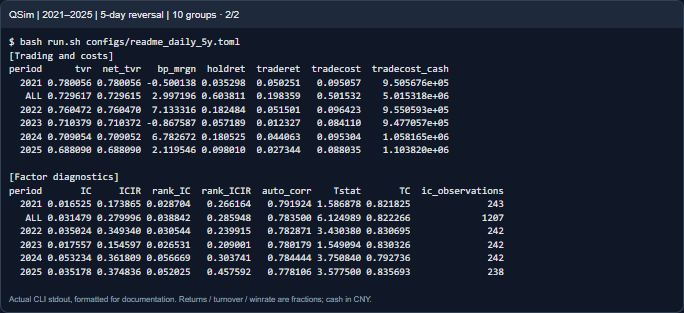


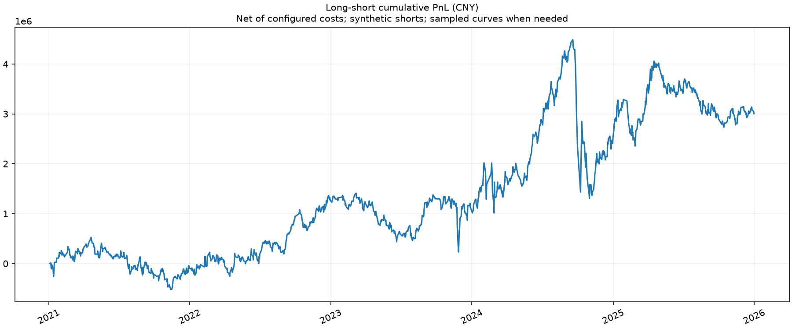


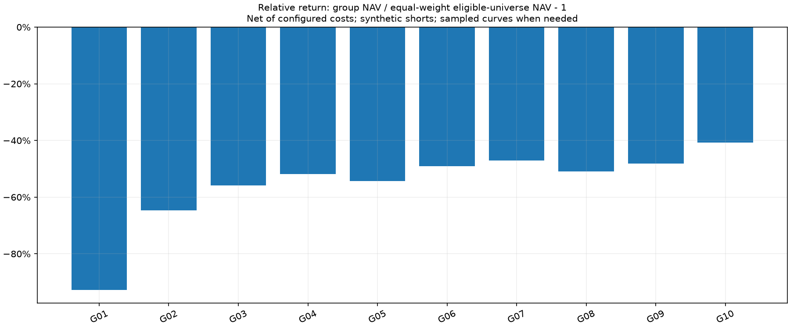

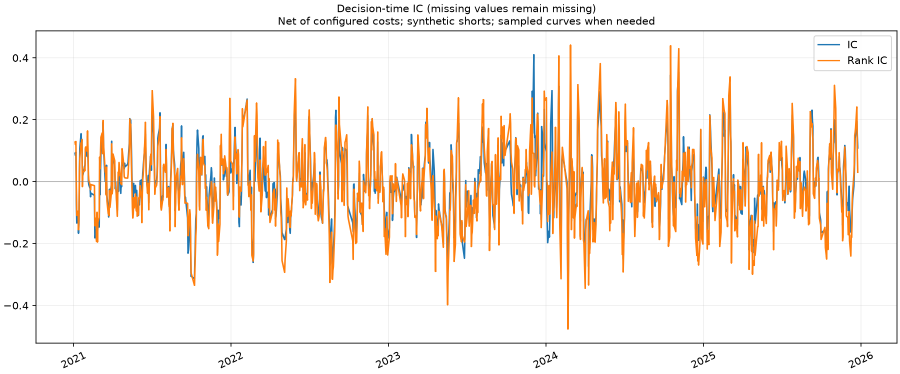

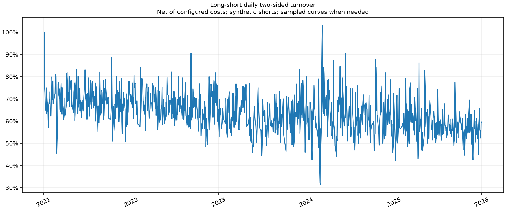


## 30分钟输出

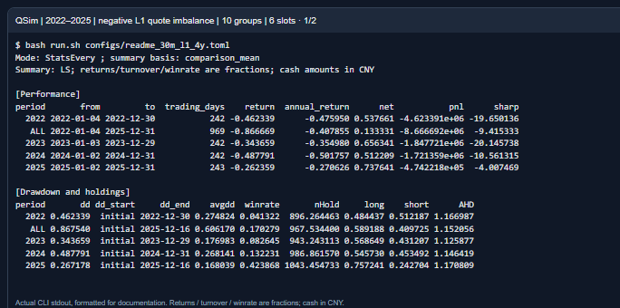

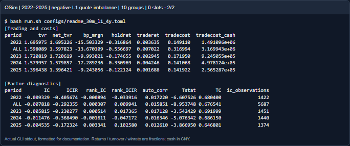

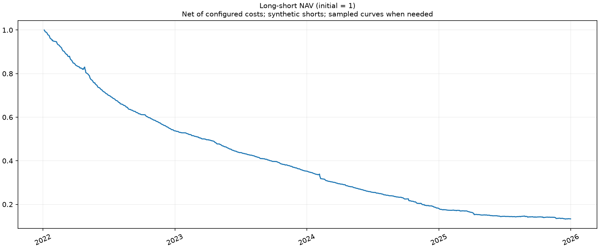

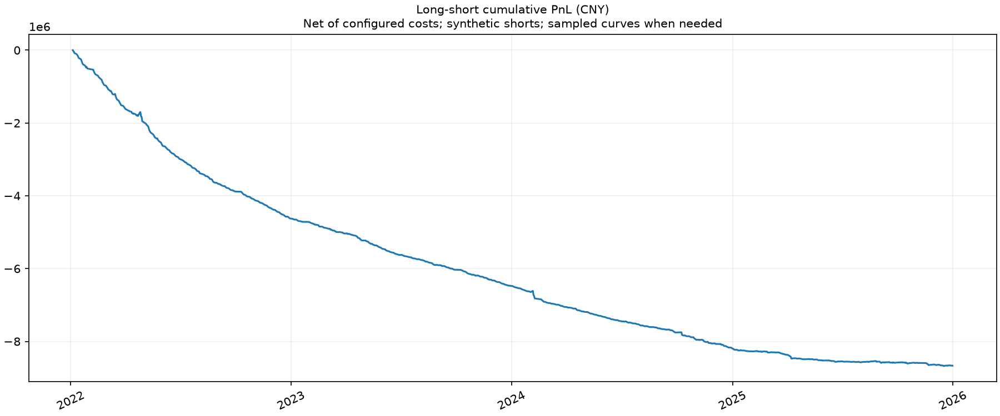

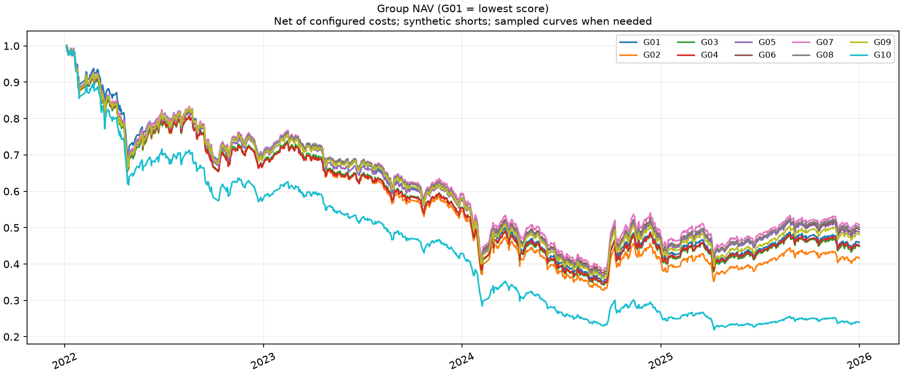

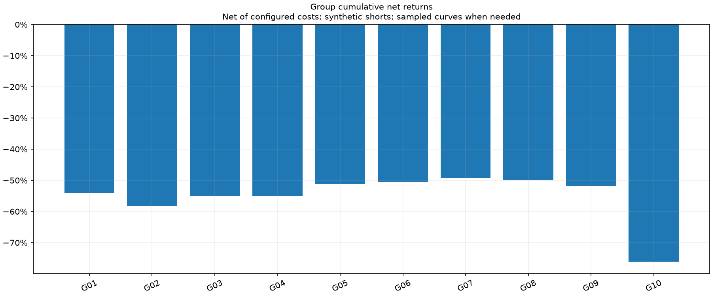

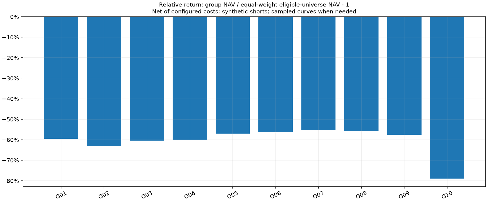

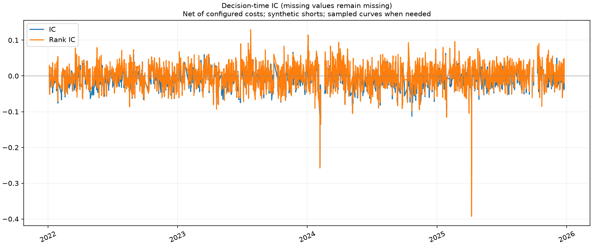

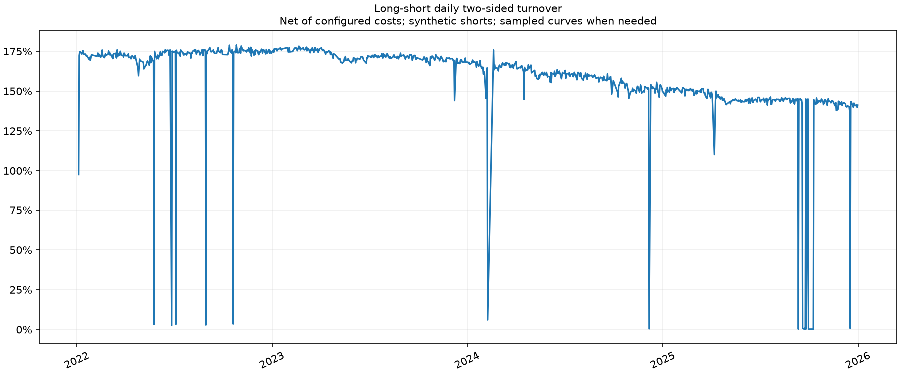

## 如何阅读分层结果

1. **分组净值**：G01–G10按同一时点因子排序形成，组内目标等权。曲线显示交易约束和成本后的账户结果，不是分组标签收益直接累加。
2. **收益与超额柱状图**：观察分组间差异及其是否接近单调，而不是看到10根柱子就默认因子有效。超额为组净值／同执行约束等权基准净值−1；基准不是某个外部指数。
3. **LS净值与金额PnL**：多G10、空G01，两侧各半。结合年度、最大回撤日期和胜率看，不只看区间终点。
   LS是独立成交和估值的多空账户，不能用“G10期末收益−G01期末收益”替代。分组多头曲线已各自扣费，而实际空头还受方向约束、成交路径和自己的资金变化影响。
4. **IC与换手**：IC检验横截面排序与后续收益关系；换手帮助解释成本与可执行性。相关性缺失、末尾标签未到期、实际未成交分别看diagnostics和audit，不能混为零收益。
5. **主结果与时点结果**：30分钟图为6时点比较均值。需要判断某个时点时，读取slot_daily／slot_summary，不能把主曲线误称为09:30策略。

原始结果、完整日志及监控仍在NAS，仅将少量文档图片入库。旧短样本素材保留为历史验收记录，当前展示不再用它们说明长期分层表现。
