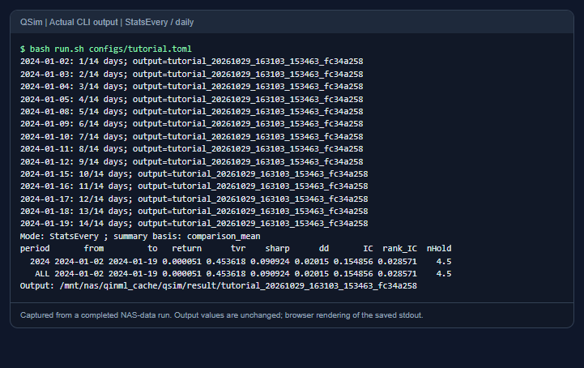
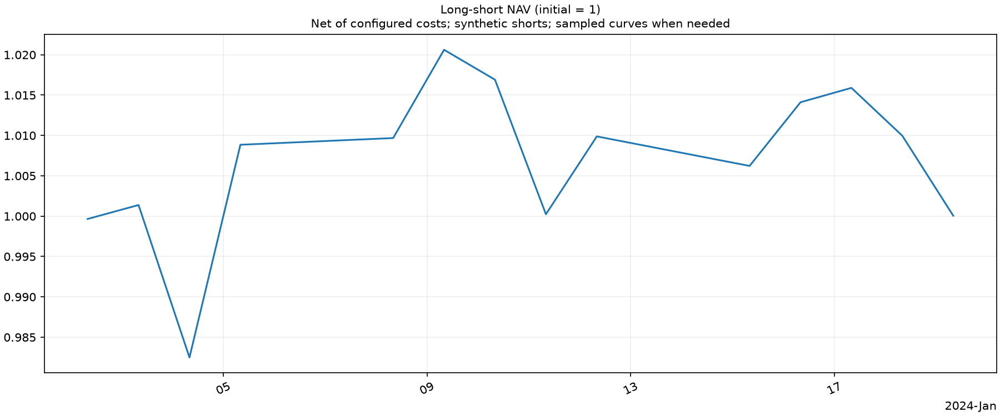
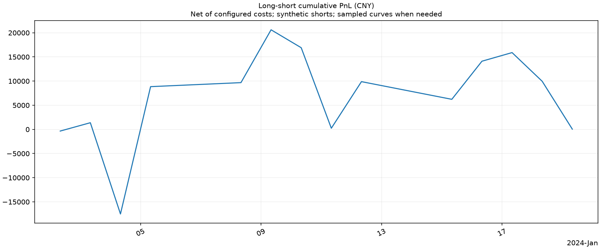
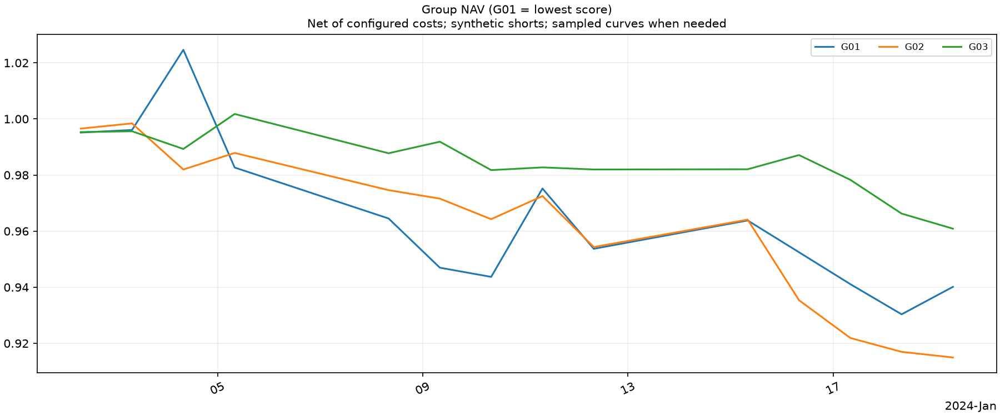
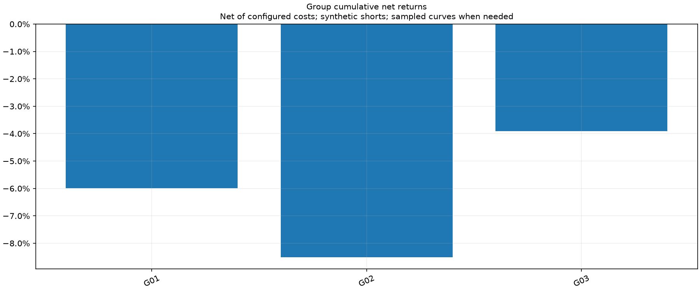
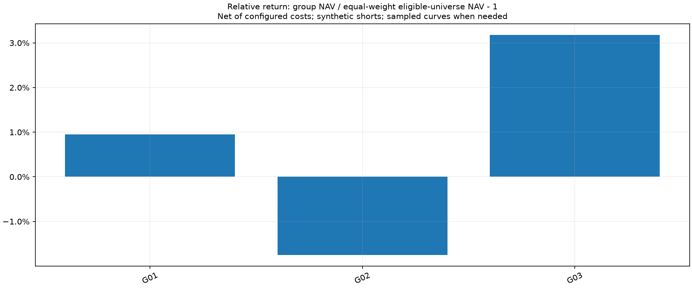
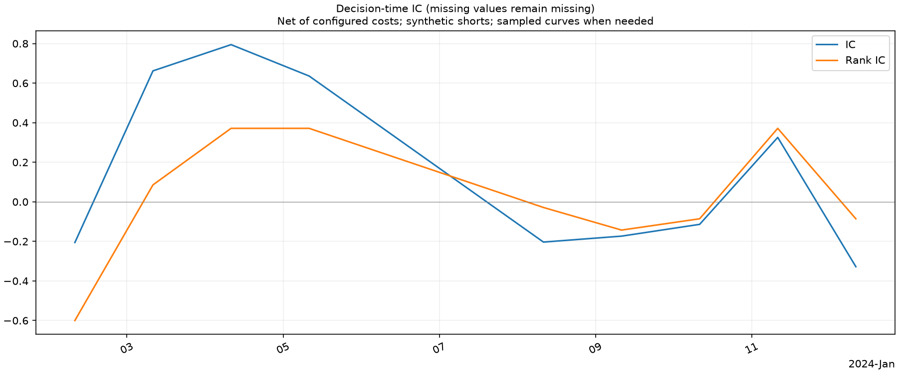
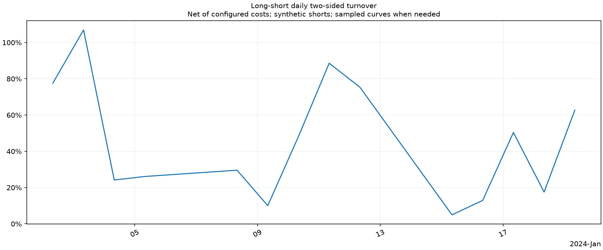

# 输出、读取与排错

[返回 README](../README.md) · [运行指南](USAGE.md) · [统计公式](../STATS.md)

本文说明 `dump=true, stream=true` 的默认流式路径。旧内存路径输出有差异，不用于长任务示例。

## 终端与日志

回测运行中每天输出一行 `日期: 已完成天数/总天数 days; output=运行ID`，结束时显示模式、统计基础、多空账户的年度／全期摘要和输出目录。多任务可能交错输出，用运行 ID 区分。



来自 [tutorial.toml](../configs/tutorial.toml) 的实际运行。截图将保存的 stdout 原文排版，未修改数值；不是手写的收益示例或交互式 dashboard。

终端摘要字段：

| 列 | 含义 | 单位 |
|---|---|---|
| period / from / to | 年度或 ALL，以及统计区间 | 日期 |
| return | 区间累计净收益 | 小数，0.01=1% |
| tvr | 日双边换手率的均值 | 小数，不除以2 |
| sharp | 年化日收益 Sharpe，无风险收益取0 | 比率 |
| dd | 最大回撤的正值幅度 | 小数 |
| IC / rank_IC | 分数与未来收益的 Pearson／Spearman 相关的时间均值 | 相关系数 |
| nHold | 日末持仓数均值 | 个 |

这里显示 LS；完整 summary 还包含各分组、long 和 short。组别的 IC/TC 是组合因子及 LS 诊断，不是每组内部重新计算。日期尾部标签未到期可以使 IC 缺失，不等于回测未成交。

`run.log` 适合顺序阅读，`run.jsonl` 每行一个 JSON 对象，适合过滤。包括运行 ID、时间、级别、阶段、进度、有效因子覆盖、输入版本、执行限制计数、资源、耗时和落盘量；错误包含堆栈。普通进度按日汇总，拒单保存计数和有限样例，不逐股票刷屏。

```bash
# RUN_DIR 指向终端 Output 打印的实际目录。
tail -f "$RUN_DIR/run.log"
```

日志中的 expired_count 当前为 null：未实现自动过期策略，不能理解为“检查后过期数为0”。拒单原因计数可能重叠，不能相加解释为独立未成交订单数。配置语法或初始化早期失败可能尚未生成完整日志。

## 文件清单

每次运行写入 `output.directory/name_时间戳_唯一ID/`，不覆盖前次结果。文件名以当前运行的 manifest.json 为准；模式和开关会影响实际内容。

| 输出 | 保存内容 | 默认格式／条件 |
|---|---|---|
| summary | 各组合年度／ALL 汇总 | JSON、Parquet；csv=true 时加 CSV |
| daily | 主账户日净值、金额PnL、换手、费用 | 分区Parquet，可选CSV |
| events | 逐事件账户估值、交易和损益归因 | 分区Parquet |
| slot_daily / slot_summary | 时点账户日曲线与统计；Every 可分别比较时点 | 分区Parquet，可选CSV |
| diagnostics | 决策时点的 IC、Rank IC、有效信号数、标签状态等 | 分区Parquet，可选CSV |
| stats_slots / stats_tvr | Every 目标 alpha 参考归因与换手 | Every；分区Parquet，可选CSV |
| stats_intervals / stats_sum / stats_sumnoend | Interval 逐段归因、日汇总及排除末段汇总 | Interval；分区Parquet，可选CSV |
| stats_ic_sum / stats_ic_sumnoend | Interval 对应 IC 汇总 | Interval；分区Parquet，可选CSV |
| benchmark_daily | 相同有效池及执行约束的等权基准日曲线 | 分区Parquet，可选CSV |
| positions | 日末持仓快照 | positions=true；分区Parquet |
| final_positions | 期末尚存持仓 | 分区Parquet；不强制平仓 |
| factors | 原值、处理后值和组合值 | factors=true；分区Parquet |
| config.json | 应用默认值和覆盖后的实际配置 | JSON |
| audit.json | 模式、数据／代码指纹、异常计数、缓冲峰值、资源与耗时 | JSON |
| manifest.json | 输出布局、各表路径与行数、完成状态 | JSON |
| run.log / run.jsonl | 人读／程序读日志 | 文本／逐行JSON |
| COMPLETE | 全部输出成功写完 | 标记文件 |
| INCOMPLETE / failure.json | 失败标记、阶段、上下文、堆栈及已保存行数 | 失败时保留 |

事件表记录组合层面的实际账户变化，**不是逐笔订单或每只股票成交回报表**。明细的所有字段可以通过 Parquet schema 查看，不要把一行 event 解释成一笔订单。

JSON 非有限浮点数保存为 null，明细表仍保留 NaN。输出目录内已经完整写出的 Parquet 分区在失败后可读，但整个 INCOMPLETE 运行不能当作完整区间结果。

同次示例运行的 summary.json 中 LS／ALL 记录如下（只摘取部分字段，完整文件还含更多指标与其他组合）：

```json
{
  "book": "LS",
  "period": "ALL",
  "from": "2024-01-02",
  "to": "2024-01-19",
  "return": 0.000051450015072340705,
  "net": 1.0000514500150723,
  "pnl": 51.45001507218694,
  "tvr": 0.45361840347565835,
  "sharp": 0.09092423136199264,
  "dd": 0.020149509973267365,
  "IC": 0.1548560472654017,
  "rank_IC": 0.028571428571428595
}
```

### Parquet 为什么看起来是文件夹

```text
events.parquet/
  part-00000000.parquet
  part-00000001.parquet
  ...
```

外层是一个逻辑表，内层是按写入顺序命名的分区文件。每天或每批写完即可释放内存，不必等一个大文件到最后才完成。读取整个表可直接传外层目录；需要节省内存时逐批读取。

### 多配置批次

多个配置统一放在第一个配置的 output.directory 下的 `batch_时间戳_ID/`。其中有 requested_configs.json、batch_config.json、batch_summary.json，以及各任务独立运行目录。实际 worker 数、每个任务状态和结果路径写在批次清单内。批次早期失败保存 batch_failure.json；一个任务失败不会把其他已完成任务的结果删掉。

## 因子值长表

| 字段 | 含义 |
|---|---|
| timestamp | 计算该分数的决策时间，上海时区 |
| instrument | 证券标识，与输入 order_book_id 对应 |
| alpha_name | 配置中的因子名；最终组合名为 combined_score |
| stage | raw / processed / combined |
| value | float64 因子值，缺失仍为 NaN |

唯一业务键为 `(timestamp,instrument,alpha_name,stage)`。原值可能保留被股票池过滤的证券信息以便诊断；处理后和组合值反映有效截面。零权重依赖因子也可能导出，文件规模约随“时点数 × 股票数 × 导出分量数”增长。

示例运行的真实记录（显示值保留6位小数，磁盘仍保存浮点精度）：

| timestamp | instrument | alpha_name | stage | value |
|---|---|---|---|---:|
| 2024-01-02 08:00:00+08:00 | 000001.XSHE | momentum | raw | -0.027950 |
| 2024-01-02 08:00:00+08:00 | 000002.XSHE | momentum | raw | -0.082456 |
| 2024-01-02 08:00:00+08:00 | 000004.XSHE | momentum | raw | -0.099888 |

读取某个 alpha/stage 后，才能将长表转成矩阵。直接删除 stage 列会制造重复键。若再作为外部 table 因子输入，需选定阶段、把 instrument 映射为 order_book_id、设置真实 available_at，不能假设导出后立即可交易。

## 读取结果

已设置 `RUN_DIR` 后，读取小型 JSON／投影明细：

```python
import json
import os
from pathlib import Path
import pandas as pd
import pyarrow.dataset as ds

run_dir = Path(os.environ["RUN_DIR"])
summary = pd.DataFrame(json.loads((run_dir / "summary.json").read_text()))
print(summary.loc[(summary.book == "LS") & (summary.period == "ALL")])

# 只取需要的列；这仍然加载该表全部日期，长任务优先下一种方式。
daily = pd.read_parquet(run_dir / "daily.parquet", columns=["date", "book", "net"])
print(daily.loc[daily.book == "LS"].tail())

# 因子表按条件、按批读取，不整表进内存。
source = ds.dataset(run_dir / "factors.parquet", format="parquet")
scan = source.scanner(
    columns=["timestamp", "instrument", "value"],
    filter=(ds.field("alpha_name") == "combined_score") & (ds.field("stage") == "combined"),
    batch_size=4096,
    use_threads=False,
)
for batch in scan.to_batches():
    print(batch.num_rows)
```

Python run() 返回的小汇总是 DataFrame，大明细默认是 DiskTable。`.iter_batches()` 按批读取；`.to_pandas()` 或 pandas 风格索引可能整表物化。result['summary'] 的读取不会自动把 events/factors 全加载回来。

## 图表怎么看

图表在结果汇总后保存为独立 PNG，无需图形桌面。长曲线使用 plot_points 控制采样目标；汇总指标仍用全量记录，NaN 不自动画成零。

| 文件 | 用途与口径 |
|---|---|
| long_short_nav.png | LS 累计净值，初始为1，已计配置成本 |
| long_short_pnl.png | LS 累计金额PnL，单位元，与净值图分开 |
| group_nav.png | 各分组净值，G01 为最低分组；比较曲线不是把组收益相加 |
| group_returns.png | 各组全期净收益柱状图，看排序和单调性 |
| group_excess_returns.png | `组净值 / 等权基准净值 − 1`，不是两个收益率直接相减 |
| ic.png | 每个决策时点的 IC 与 Rank IC，观察方向、稳定性及缺失 |
| turnover.png | LS 日双边换手率，联系成本理解 |

以下均为同一配置、同一次 NAS 数据运行的原始 PNG。样本只用于展示接口和阅读方式，不据此评价策略。

**多空净值与金额 PnL**





**分组净值、收益和超额**







**IC 与换手**





等权基准与策略使用同一时点具备有限分数的有效证券池、相同执行与费用约束；不是外部指数，也不是分组收益平均。Every 对策略和基准都采用时点等初始资金比较均值。旧内存路径不构造该基准，超额图会注明不可用。

## 常见问题

| 现象 | 先查什么 |
|---|---|
| --validate 成功，运行找不到文件 | 校验不读数据；检查 data.root/raw_root、频率分区和外部表路径；相对路径基于当前工作目录 |
| historical ST status missing | 检查 st_path、历史覆盖与 st_unknown 策略；不要为了消除报错默认把未知当非ST |
| 有因子输入但无有效信号 | 检查 available_at、预热、各分量共同有限值、min_cross_section、分组数、常数截面与中性化样本数 |
| 有目标但交易不足 | 查看 execution 计数、rejection_samples，区分T+1、容量、停牌、涨跌停、资金和无效价格 |
| 最后几天 IC 缺失 | 看 label_status 是否 right_censored；回测终点后没有标签，不能当0 |
| pandas读Parquet文件夹失败 | 检查目录内是否含非Parquet文件、是否拿错上层运行目录，以及是否是失败运行的未完成分区 |
| 实际并发小于 pools | 看资源预算、CPU配额和内存；pools 是请求上限，不是强制数量 |
| 内存超预算退出 | 查看 run.jsonl 阶段与RSS，先减少股票／账户／窗口或dump量，测量后调整预算；不要直接开更多worker |
| 输出有 INCOMPLETE | 先读 failure.json/run.jsonl；保留证据，换新运行目录复跑，不能冒充完整结果 |
| livetest 不是 PASS | 读取单项状态与首个差异；INSUFFICIENT_DATA/UNSUPPORTED 也不是通过。见[检查说明](LIVETEST.md) |
