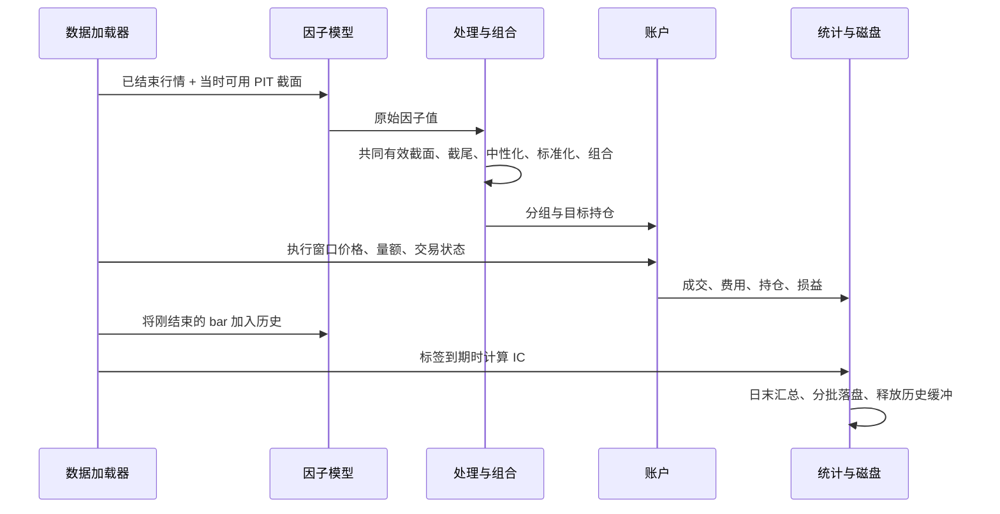

# 运行指南

[返回 README](../README.md) · [配置字典](CONFIGURATION.md) · [数据规范](DATA.md) · [输出说明](OUTPUTS.md)

本文默认共享 NAS 行情已经可读，Python 环境和缓存目录已按 README 设置。所有命令在项目根目录执行。QSim 不修改共享行情；自定义配置放代码目录，缓存与结果放独立 NAS 工作目录。

## 建立一个任务

1. 复制 [tutorial.toml](../configs/tutorial.toml) 为自己的配置，例如 `configs/local_research.toml`。不要覆盖已有任务配置；`local*.toml` 默认不提交 Git。
2. 检查 data 与 output 的路径。设置回测日期、预热长度、frequency、mode、groups 和 capital。
3. 选择 all_a、symbols 或历史 table 标的池。先用较小股票池和短日期验证流程。
4. 在 `[alphas.NAME]` 定义因子，设置 operations 和 combine。已有外部值使用 table，已有表达式使用 expression；不要把未来标签当作因子。
5. 执行配置校验、普通回测，再查看日志与结果。需要检查因果性时单独运行 livetest。

```bash
cp -n configs/tutorial.toml configs/local_research.toml
# 编辑 configs/local_research.toml 后执行：
python -m qsim --config configs/local_research.toml --validate
python -m qsim --config configs/local_research.toml
python -m qsim --config configs/local_research.toml --livetest all
```

`--validate` 验证配置类型、参数组合和表达式依赖，并打印最终配置；**不读取行情，也不证明外部表存在、字段完整或预热充分**。普通回测成功也不代表没有缺失标签，要继续检查 diagnostics 与 audit。

## 一个决策时点发生什么



1. **初始化**：读取最终配置和日历，建立固定证券轴；预热日只向因子历史加入已完成价格，不建立交易仓位。
2. **选可用证券**：生命周期池与自定义池取交集，再按配置过滤停牌、ST；未知 ST 使用显式策略。
3. **算原值**：内置因子只看已完成 bar；外部表只查询 `available_at <= decision_time`。当日全天行情虽可从磁盘加载用于模拟，但不能提前加入因子历史。
4. **处理与合成**：默认在参与合成因子的共同有限截面分别截尾、可选中性化、标准化，然后按公式或权重合成。无任何训练区间拟合步骤。
5. **分组**：有限分数按从低到高划分 G01…Gnn。相同分数用稳定证券顺序处理；最高组做多、最低组做空，LS 两侧各占一半目标资金。各分组、long、short、LS 是供比较的独立组合，不是同一账户所有仓位相加。
6. **执行**：Every 等待配置的延迟 bar；Interval 使用选定区间。成交还受现金、容量、T+1、停牌和涨跌停约束，目标仓位不等于实际成交仓位。
7. **估值与标签**：按价格更新净资产；当标签到期后，才将当时的分数与后续收益关联计算 IC。超过终点的标签标记 right_censored，不补成零收益。
8. **保存**：每日写事件、持仓和统计，按批写因子明细；释放已经写出的历史缓冲，保留当前账户、滚动窗口与未到期标签。

Every/Interval 整个截面无法分组时沿用此前目标，但退出有效池的证券目标置零；实际退出仍可能受交易限制。不是遇到缺失就无条件清空账户，也不是强行对剩余因子重新加权。

## 选择采样与账户模式

以下片段用于**替换对应键**，不是在已有 TOML 末尾重复声明同一个表。其余数据、因子、费用和输出沿用完整模板。

### 日频

```toml
[backtest]
start = "2024-01-02"
end = "2024-01-19"
frequency = "0800"
mode = "StatsEvery"
holding_period = 1
forecast_period = 5
groups = 3
capital = 1000000.0

[stats]
nIntvDelay = 1
signal_times = []
```

08:00 取信号，当天全天 VWAP 成交；内置价格因子只能用前一交易日及更早收盘。日频不是 08:00 的真实成交报价。factor lookback=20 至少需要21个已完成收盘，预热30个交易日可以覆盖该有限窗口。

### StatsEvery：固定时点独立账户

```toml
[backtest]
frequency = "0930-1450-5"
mode = "StatsEvery"
holding_period = 1

[stats]
signal_times = ["0930", "1000"]
nIntvDelay = 1
priceMode = "vwap"
isTradeT1 = true
```

```text
09:30 账户：周一09:30调仓 ── 持有 ── 周二09:30调仓
10:00 账户：周一10:00调仓 ── 持有 ── 周二10:00调仓
             两套账户各自维护现金、持仓、成本和历史目标
```

- nIntvDelay=1：10:00 信号使用 `(10:00,10:05]` VWAP；设2使用 `(10:05,10:10]`。
- signal_times 空列表：每个有执行窗口的采样起点建立一套时点账户；上述全窗口并不是一套账户调仓46次。
- `slot_daily/slot_summary` 保留单时点；主 `daily/summary` 对相同 book 的时点账户按等初始资金汇总为比较均值，金额取平均，收益按平均净资产变化计算。统计指标由这条汇总日曲线计算，不是各时点 Sharpe 简单平均。
- `stats.isTradeT1` 只选择参考目标换手按时点均值或求和；实际交易是否 T+1 由 `execution.enforce_t1` 控制。

### StatsInterval：同一账户按区间推进

```toml
[backtest]
frequency = "0930-1450-5"
mode = "StatsInterval"
holding_period = 1

[stats]
signal_times = []
nbar = 2
nIntvDelay = 1
priceMode = "vwap"
cleareod = false
```

```text
同一组合账户：09:30 信号 → (09:30,09:40] 执行
                         → 09:40 信号 → (09:40,09:50] 执行 → …
现金和持仓连续传递；不会每个区间重新初始化一笔资金。
```

区间 VWAP 是量额聚合后的比值。priceMode=open 用段首开盘，close 用段尾收盘。尾部不足 nbar 时截断；不跨交易日。参考统计中的 `/nbar` 是归一化口径，不会把真实账户 PnL 除以 nbar。

`cleareod=true` 清的是当日首次参考计算前的 lastAlpha，不是实际日终平仓。日频 Interval 只支持 nbar=1。

### Cohort：兼容模式

每次信号形成一个持有 holding_period 根采样 bar 的批次，允许多批次并存。主要用于兼容旧研究任务；新任务优先根据实际调仓语义选择 Every 或 Interval。它不能通过修改 holding_period 把 Every 自动变成同一账户的任意持有期策略。

## 加载外部因子与合成

以下为配置片段，路径替换为你的 NAS 因子表。共享行情的路径不变：

```toml
[alphas.quality]
kind = "table"
path = "/absolute/nas/path/signals.parquet"
column = "quality"
weight = 1.0

[alphas.value]
kind = "table"
path = "/absolute/nas/path/signals.parquet"
column = "value"
weight = 1.0

[combine]
expression = "0.5*(<quality> + <value>)"
stage = "processed"
```

先分别处理再合成是默认方式；需要研究原始尺度时显式选 stage=raw。全局公式只能引用已配置名称；派生 expression 因子读取上游原值，区别见[配置字典](CONFIGURATION.md#alphasname-与-combine)。数据表的列不是表达式本身，不会自动把字符串列中的公式执行成代码。

## 计算与内存

| 工作 | 执行方式 | 主要影响因素 |
|---|---|---|
| 同时点的 N 只股票 | NumPy 数组向量化 | 股票数、窗口长度、截面回归规模 |
| 同配置多个因子 | compute.pools 控制线程池；默认串行 | 因子独立性、NumPy 运算占比、依赖深度 |
| 多个独立配置 | compute.batch_pools 或 --pools 控制进程池 | NAS 读写、进程当前数组、账户数 |
| StatsEvery 时点账户 | 顺序执行 | 时点数 × 组合数 |
| 同一账户时间推进 | 串行 | 当前状态依赖前一事件 |
| GPU／多机 | 未实现 | — |

### 一个配置的因子池

```bash
python -m qsim --config configs/tutorial.toml --factor-pools 2
```

同一物理 PIT 源只推进一次；因子线程共享当前截面。同一依赖层可并行，相同基础计算复用；最终组合顺序确定。增加线程不保证提速，特别是因子很轻或读盘占主导时。

### 多个配置的回测池

准备两个独立配置，各自设置因子、日期或参数后：

```bash
python -m qsim --config configs/local_a.toml configs/local_b.toml --pools 2
```

任务使用 spawn 进程和有界队列。批次预先合并同源列需求，建立共享 PIT 索引；行情使用版本化 Arrow mmap 缓存。每个进程仍需自己的当前矩阵与账户状态，不是全流程零复制。任务池与因子池嵌套时会限制放大。

### 长任务前检查什么

1. 查看 MemAvailable、CPU 空闲／负载、其他任务以及适用的 cgroup／调度器配额。按更严格的剩余资源计算预算。
2. 从小标的池、短日期、1个worker开始测量，关注峰值RSS、耗时、读取量、写出字节，而不只看 CPU 利用率。
3. 设置 memory_per_job_mb 和有限 pools，保留系统余量；使用 cgroup／调度器约束整组任务，线程数和 nice 不能代替内存硬限制。
4. 运行中看 run.jsonl 的资源、阶段耗时和落盘进度。缓存首次构建与暖缓存复跑分别衡量；旧缓存不会自动清理。

程序按观测空闲与可见配额的50%预算收缩并发，配额不可见时保守串行；运行中定期检查RSS和剩余内存，超预算会保留已写分区并退出。这不保证任何规模都不会 OOM。

固定股票数、窗口、账户数时，主历史明细已按日／批释放，但日历、年度小汇总等仍随跨度有少量增长。显式 `to_pandas()`、materialize=true、stream=false 或 dump=false 都可能将大结果放回内存。

## Python 调用

设置好 README 中的存储和线程环境后：

```python
from qsim import run

result = run("configs/tutorial.toml")
print(result["summary"].query("book == 'LS'"))
print(result["output_directory"])

for batch in result["events"].iter_batches(
    columns=["timestamp", "book", "pnl"], batch_size=4096
):
    frame = batch.to_pandas()
    print(len(frame), frame["pnl"].sum())
```

summary 是小型 DataFrame；流式大表是 DiskTable。Python 多进程调用要把入口放在 `if __name__ == "__main__":` 内，避免 spawn 重复执行顶层代码；CLI 已处理入口。

## 检查、退出与恢复边界

普通回测完成后终端显示 Output。失败时返回非零，查看 INCOMPLETE、failure.json 和 run.jsonl；配置解析前失败可能还没有运行目录。

```bash
python -m qsim --config configs/tutorial.toml --livetest f,p
python -m qsim --config configs/tutorial.toml --livetest all
```

这只执行 alpha 重放检查，不同时做资金账户回测。f/p/c 任一不是 PASS 都返回非零，包括数据不足和不支持；报告始终保留。多配置入口不接受 --livetest，需要分别检查。

alpha checkpoint 与完整账户恢复不同。当前失败后能读取已经保存的分区，但不能直接把这些分区当作资金账户断点续跑状态。详见[一致性检查](LIVETEST.md)。
